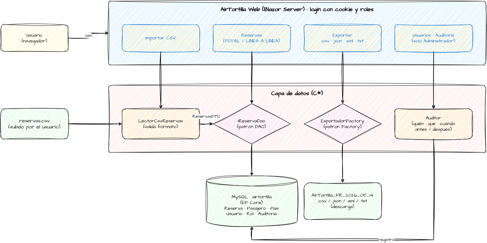
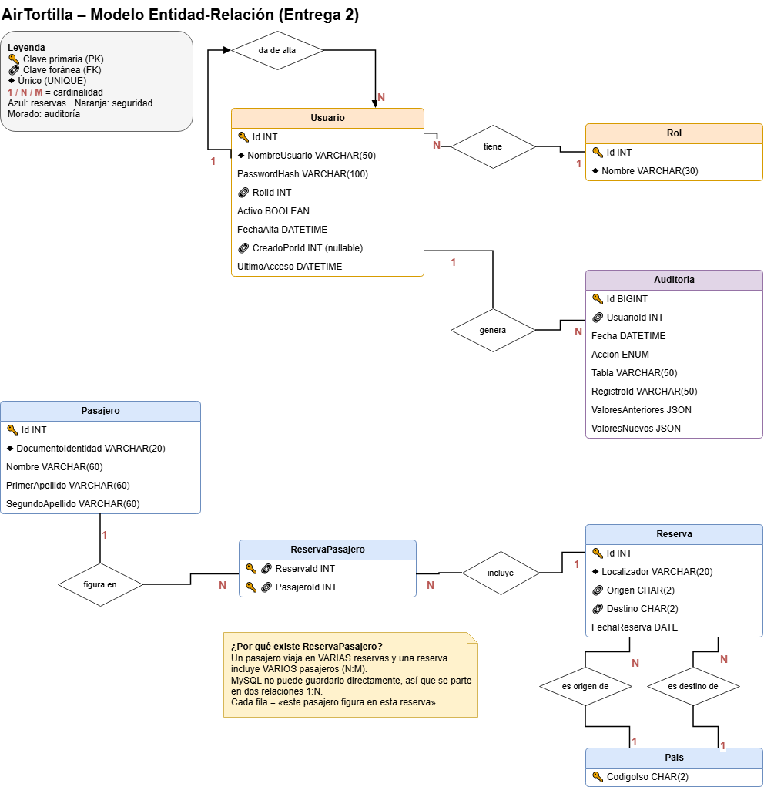

# AirTortilla · Gestión de reservas

## Índice

1. [Instalación y ejecución](#instalación-y-ejecución)
2. [Objetivos de la entrega 2](#objetivos-de-la-entrega-2)
3. [Migración de tecnología](#migración-de-tecnología)
4. [Arquitectura](#arquitectura)
5. [Modelo de datos](#modelo-de-datos)
6. [User Stories y tareas medibles](#user-stories-y-tareas-medibles)
7. [Seguridad](#seguridad)
8. [Patrones de diseño](#patrones-de-diseño)
9. [Formato del CSV](#formato-del-csv)
10. [Conclusión](#conclusión)

---

## Instalación y ejecución

Solo necesitas **Docker Desktop** y **GitHub Desktop** (o descargar el ZIP).

### 1. Descargar el proyecto

- **Con GitHub Desktop:** en <https://github.com/marianaangarita/ProyectoFicherosMarianaAngarita>, pulsa **Code → Open with GitHub Desktop** y después **Clone**. Puedes dejar la carpeta que propone, salvo que esté dentro de OneDrive (en ese caso elige otra, por ejemplo `C:\Repos`).
- **Sin GitHub Desktop:** **Code → Download ZIP** y descomprímelo fuera de OneDrive.

### 2. Abrir Docker Desktop

Espera a que ponga **"Engine running"**.

### 3. Abrir el proyecto en Visual Studio Code

1. En GitHub Desktop, pulsa **Open in Visual Studio Code** (o en VS Code: **File → Open Folder...** y elige la carpeta del proyecto).
2. Abre una terminal: menú **Terminal → New Terminal**.

La terminal se abre directamente en la carpeta del proyecto, la que contiene `docker-compose.yml`.

### 4. Arrancar

```
docker compose up -d --build
```

La primera vez tarda unos minutos (descarga MySQL y .NET). Después comprueba que los dos contenedores están en marcha:

```
docker compose ps
```

`airtortilla-db` debe aparecer como **Up (healthy)** y `airtortilla-web` como **Up**.

### 5. Entrar

Abre **<http://localhost:8080>** con el usuario **`admin`** y la contraseña **`AdminDemo2026`**.

Para probar, importa el [CSV de prueba](#csv-de-prueba), consulta y exporta las reservas, da de alta un usuario *Empleado* y revisa la *Auditoría*.

### Comandos útiles

| Quiero... | Comando |
|---|---|
| Apagar | `docker compose stop` |
| Volver a encender | `docker compose start` |
| Empezar de cero (borra los datos) | `docker compose down -v` y después `docker compose up -d --build` |

### Si algo falla

| Problema | Solución |
|---|---|
| Error de conexión con Docker | Docker Desktop no está abierto o aún no pone "Engine running". |
| `no configuration file provided` | La terminal no está en la carpeta del proyecto. |
| Se cortó el primer arranque o `airtortilla-web` sale como *Restarting* | `docker compose down -v` y vuelve a arrancar. |
| Puerto 8080 ocupado | En `docker-compose.yml` cambia `"8080:8080"` por `"8081:8080"` y entra en `localhost:8081`. |
| Los botones no responden | Recarga la página con `F5`. |

> Las contraseñas del archivo `.env` son **de demostración**: solo sirven para la base de datos que Docker crea en tu propio ordenador, accesible únicamente desde él.

---

## Objetivos de la entrega 2

| ID | User Story |
|---|---|
| **US1** | Como **Empleado** quiero poder hacer *log in* para acceder a los recursos de la compañía. |
| **US2** | Como **Administrador** quiero poder dar de alta usuarios para garantizar la seguridad interna de la aplicación. |
| **US3** | Como **Administrador** quiero mantener la trazabilidad de las modificaciones. |

Además, se migra toda la persistencia a una **base de datos relacional** y se añaden contenedores (Docker).

---

## Migración de tecnología

Esta es la última entrega que permite cambiar el stack sin coste, así que se documentan los cambios:

| Capa | Entrega 1 | Entrega 2 |
|---|---|---|
| Interfaz | Consola | **Blazor Server** (web) |
| Persistencia | Ficheros CSV/JSON/XML/TXT | **MySQL 8** |
| Acceso a datos | `StreamReader` / `File` | **Entity Framework Core 10** |
| Seguridad | — | Login con cookie, roles y **BCrypt** |
| Ejecución | `dotnet run` | **Docker Compose** |

Las funciones de la entrega 1 se mantienen:

| Consola (entrega 1) | Web (entrega 2) |
|---|---|
| Opción 1: leer CSV y generar ficheros | **Importar CSV** guarda en MySQL; los ficheros se generan al **exportar** |
| Opción 2: consulta total | Botón **Total** |
| Opción 3: línea a línea (`ENTER` / `Q`) | Botón **Línea a línea** ("Siguiente" / "Salir") |
| Códigos ISO en un `HashSet` del código | Tabla `Pais` en la base de datos |

El proyecto de consola se ha eliminado del repositorio; su código sigue en el historial de Git (Pull Request #1).

---

## Arquitectura



```
AirTortilla.Web/
├── Components/Pages/   Login, Inicio, Importar, Reservas, Usuarios, Auditoria
├── Data/
│   ├── Entities/       Entidades de EF Core
│   ├── DAO/            IReservaDao + ReservaDaoMySql
│   ├── CSV/            LectorCsvReservas
│   ├── Exportacion/    Exportadores + ExportadorFactory
│   └── Auditor.cs      Registro de auditoría
├── DTO/                ReservasDTO
└── Program.cs          Configuración (BD, login, rutas)
database/               Script SQL y diagrama ER
docker-compose.yml      MySQL + aplicación
```

---

## Modelo de datos



Script: [`database/airtortilla_schema.sql`](database/airtortilla_schema.sql). Siete tablas: `Pais`, `Reserva`, `Pasajero`, `ReservaPasajero`, `Rol`, `Usuario` y `Auditoria`.

Decisiones principales:
- **Reserva N:M Pasajero**, resuelta con la tabla intermedia `ReservaPasajero`. Un pasajero que viaja en dos reservas se guarda una sola vez.
- **Origen, destino y fecha son de la reserva**: todos los pasajeros de un localizador viajan juntos.
- **Los usuarios se desactivan, no se borran**, para no perder su rastro en la auditoría.
- **`Usuario.CreadoPorId`** guarda qué administrador dio de alta a cada usuario.

---

## User Stories y tareas medibles

| US | Tarea | Cómo se comprueba |
|---|---|---|
| US1 | Contraseñas con BCrypt | En la tabla `usuario`, `PasswordHash` empieza por `$2a$11$` |
| US1 | Login y cierre de sesión | Credenciales correctas → "Hola, *usuario*"; incorrectas → "Usuario o contraseña incorrectos" |
| US1 | Páginas protegidas | Sin sesión, `/reservas` redirige a `/login` |
| US2 | Alta solo para Administrador | Un Empleado no ve *Usuarios* y en `/usuarios` recibe "Acceso denegado" |
| US2 | Validación del alta | Nombre de 3–50 caracteres, contraseña de 8 o más, rol obligatorio, sin repetidos |
| US2 | Activar / desactivar | Un usuario desactivado no puede entrar y, si estaba dentro, se le expulsa |
| US3 | Registro de auditoría | Logins, altas, modificaciones, importaciones y exportaciones quedan registrados con usuario, fecha y valores antes/después |
| US3 | Consulta de auditoría | `/auditoria` (solo Administrador), filtrable por acción y de solo lectura |
| BD | Migración | El CSV de prueba importa 5 reservas con 4 avisos; importarlo otra vez no duplica nada |
| BD | Consultar y exportar | *Total*, *Línea a línea* y exportación a CSV, JSON, XML y TXT |
| BD | Docker | Con solo Docker Desktop, la aplicación funciona en `localhost:8080` |

---

## Seguridad

- **Contraseñas con BCrypt:** solo se guarda el hash.
- **Mismo mensaje para cualquier fallo de login:** no revela qué usuarios existen.
- **Todas las páginas protegidas por defecto**, y **Usuarios** y **Auditoría** solo para el rol Administrador.
- **Sesión revalidada en cada petición:** un usuario desactivado es expulsado.
- **Protección CSRF** en formularios y cierre de sesión.
- **Ninguna contraseña en el código:** *user-secrets* en desarrollo y `.env` en Docker.
- **La aplicación no usa `root`:** tiene su propio usuario de MySQL, y el puerto de la base de datos solo es accesible desde el propio ordenador.

---

## Patrones de diseño

- **DTO:** `ReservasDTO` transporta los datos entre el CSV, la base de datos y los ficheros exportados.
- **DAO:** las páginas usan la interfaz `IReservaDao`; la implementación (`ReservaDaoMySql`) se elige en una línea de `Program.cs`. Volver a ficheros solo requeriría otra implementación.
- **Factory:** `ExportadorFactory.Crear("json")` devuelve el exportador adecuado. Añadir un formato es una clase nueva más una línea en la fábrica.

---

## Formato del CSV

Mismo formato que la entrega 1: UTF-8, primera línea de cabecera, separado por comas y sin comas dentro de los campos.

| Columna | Restricción | Ejemplo |
|---|---|---|
| Localizador | Obligatorio, máx. 20 | LOC001 |
| Destino / Origen | Código ISO de 2 letras (Reino Unido es `GB`, no `UK`) | FR / ES |
| NombrePasajero, PrimerApellido, SegundoApellido | Máx. 60 (el segundo apellido es opcional) | Juan, Perez, Gomez |
| DocumentoIdentidad | Obligatorio, máx. 20 | 11111111A |
| FechaReserva | `yyyy-MM-dd` | 2026-05-14 |

Las filas incorrectas se omiten con un aviso que indica la línea y el motivo. Los localizadores que ya existen no se vuelven a importar.

### CSV de prueba

Los CSV no se incluyen en el repositorio. Copia esto en el Bloc de notas y guárdalo como `reservas.csv` (tipo *Todos los archivos*, codificación *UTF-8*):

```csv
Localizador,Destino,Origen,NombrePasajero,PrimerApellido,SegundoApellido,DocumentoIdentidad,FechaReserva
LOC001,FR,ES,Juan,Perez,Gomez,11111111A,2026-05-14
LOC001,FR,ES,Juan,Perez,Gomez,22222222B,2026-05-14
LOC001,FR,ES,Juan,Perez,Gomez,33333333C,2026-05-14
LOC001,FR,ES,Juan,Perez,Gomez,44444444D,2026-05-14
LOC001,FR,ES,Juan,Perez,Gomez,55555555E,2026-05-14
LOC002,IT,ES,Maria,Garcia,Lopez,66666666F,2026-05-14
LOC002,IT,ES,Maria,Garcia,Lopez,77777777G,2026-05-14
LOC003,FR,ES,Ana,Martin,Ruiz,88888888H,2026-05-15
LOC003,FR,ES,Ana,Martin,Ruiz,99999999J,2026-05-15
LOC004,FR,ES,Juan,Perez,Gomez,11111111A,2026-05-15
LOC005,DE,PT,Lucas,Silva,,12345678K,2026-05-16
LOC006,UK,ES,Peter,Smith,,23456789L,2026-05-16
LOC007,FR,ES,Laura,Sanz,Gil,34567890M,2026-13-45
LOC008,FR,ES,Carlos,Ruiz
LOC009,FR,ES,Elena,Diaz,Mora,45678901N,2026-05-17
LOC009,IT,ES,Pablo,Diaz,Mora,56789012P,2026-05-17
```

**Resultado esperado:** 5 reservas importadas, 10 pasajeros nuevos y 4 avisos (LOC006 con un código ISO incorrecto, LOC007 con una fecha imposible, LOC008 con columnas que faltan y LOC009 con dos destinos distintos). El pasajero `11111111A` aparece en LOC001 y LOC004, pero se guarda una sola vez.

Cada grupo de destino y fecha se exporta como `AirTortilla_XX_YYYY_MM_DD` en CSV, JSON, XML o TXT.

---

## Conclusión

La entrega cumple las tres User Stories y la migración a MySQL, mantiene todas las funciones de la entrega 1 desde una interfaz web y se ejecuta con un solo comando gracias a Docker.

**Limitaciones conocidas**
- Los campos del CSV no pueden contener comas.
- Un usuario desactivado que esté en una página abierta no es expulsado hasta que navega o recarga.
- El usuario de MySQL de la aplicación podría borrar la auditoría con acceso directo a la base de datos (desde la aplicación no es posible).
- El `.env` con contraseñas de demostración está en el repositorio para facilitar la evaluación; en un entorno real no se subiría.

**Posibles mejoras**
- Admitir campos entre comillas en el CSV (CsvHelper).
- Cambio de contraseña y bloqueo tras varios intentos fallidos.
- Paginación en la auditoría y en las reservas.
- Pruebas unitarias.
