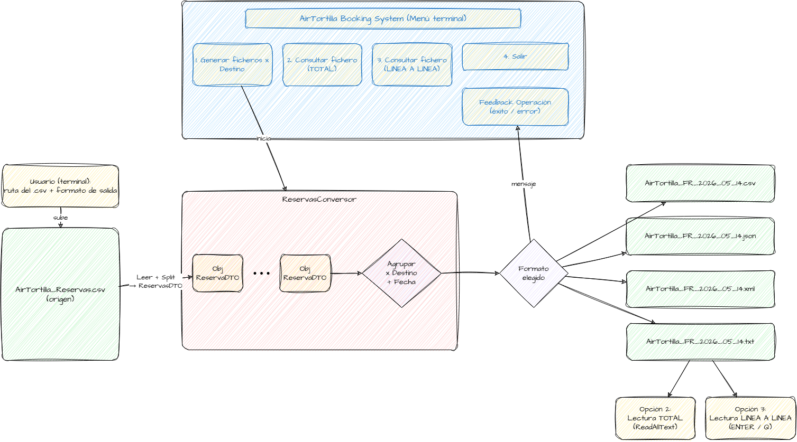

## Arquitectura del Sistema

A continuación se detalla el flujo de datos desde la lectura del CSV hasta la generación de los ficheros:



## Formato del CSV de entrada

- Codificación: UTF-8.
- La primera línea es una cabecera y se ignora.
- Separador: coma (`,`). Los campos no pueden contener comas.
- Columnas (en este orden):

| Columna | Descripción | Ejemplo |
|---|---|---|
| Localizador | Código único de reserva. Varios pasajeros pueden compartirlo | AT1001 |
| Destino | Código ISO 3166-1 alfa-2 del país | FR |
| Origen | Código ISO 3166-1 alfa-2 del país | ES |
| NombrePasajero | Nombre | Maria |
| PrimerApellido | Primer apellido | Garcia |
| SegundoApellido | Segundo apellido | Lopez |
| DocumentoIdentidad | Identificador único del pasajero | 10000001A |
| FechaReserva | Formato `yyyy-MM-dd` | 2026-05-14 |

-Ejemplo:

```csv
Localizador,Destino,Origen,NombrePasajero,PrimerApellido,SegundoApellido,DocumentoIdentidad,FechaReserva
LOC001,FR,ES,Juan,Perez,Gomez,11111111A,2026-05-14
LOC002,FR,ES,Juan,Perez,Gomez,22222222B,2026-05-14
LOC003,FR,ES,Juan,Perez,Gomez,33333333C,2026-05-14
LOC004,FR,ES,Juan,Perez,Gomez,44444444D,2026-05-14
LOC005,FR,ES,Juan,Perez,Gomez,55555555E,2026-05-14

### Restricciones

- **Ningún campo puede contener comas.** El programa separa los campos con `Split(',')`
  y no admite comillas, así que una coma dentro de un campo desplazaría las columnas.
  Las filas que no tengan exactamente 8 campos se omiten con un aviso.
- Los códigos ISO de Destino y Origen se validan contra la lista oficial ISO 3166-1 alfa-2
  (249 códigos), sin distinguir mayúsculas y minúsculas. Códigos no oficiales como `UK`
  o `XK` se rechazan (Reino Unido es `GB`).
- Las filas vacías se ignoran. Las filas con campos de más o de menos, código ISO no válido
  o fecha no válida se omiten mostrando un aviso con el número de línea.

## Ficheros generados

- Se genera un fichero por cada combinación de país de destino y fecha de reserva:
  `AirTortilla_XX_YYYY_MM_DD.<ext>` (csv, json, xml o txt, según la elección del usuario).
- Los ficheros se generan en orden de destino y fecha, y las reservas de cada fichero
  se ordenan por localizador y, dentro del mismo localizador, por documento de identidad.
- Los CSV de prueba y los ficheros generados no se incluyen en el repositorio (ver `.gitignore`).


